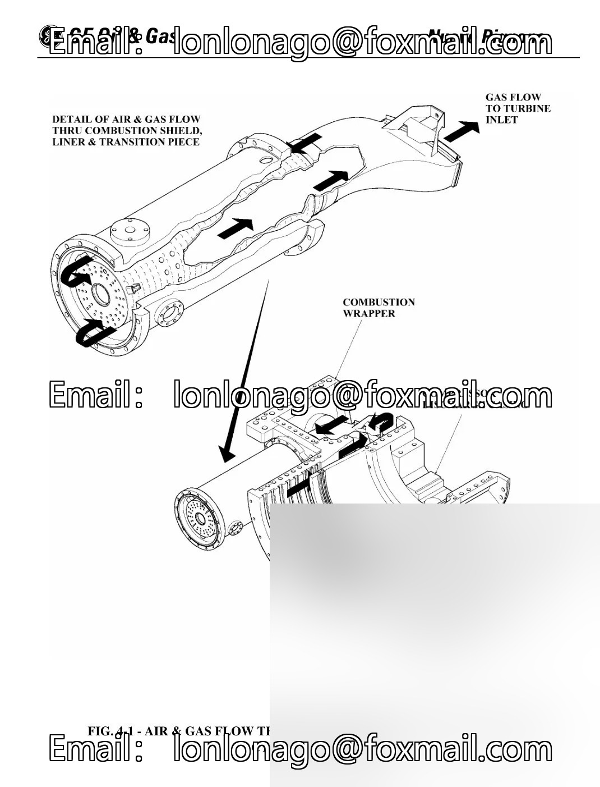
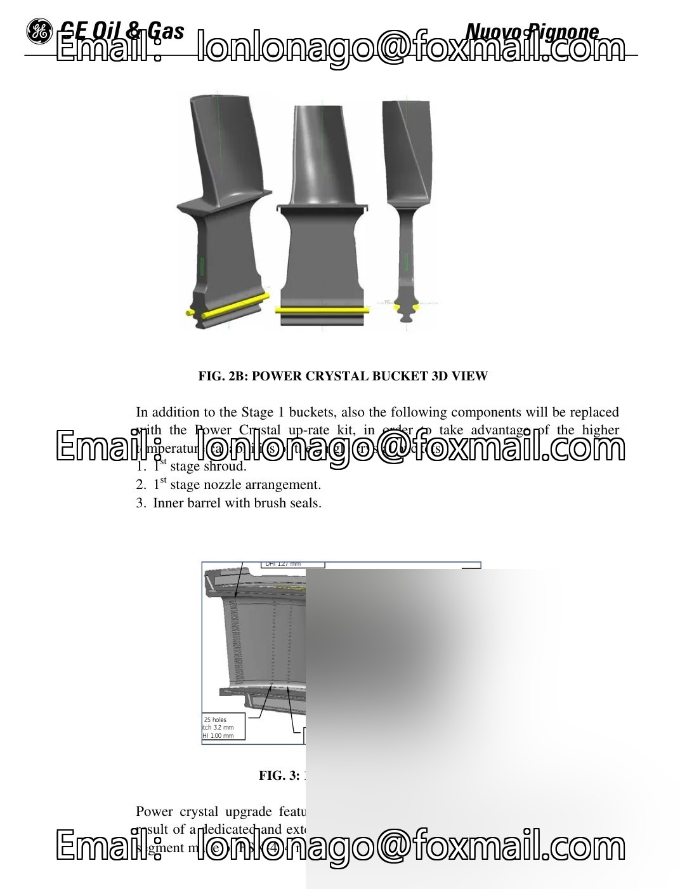
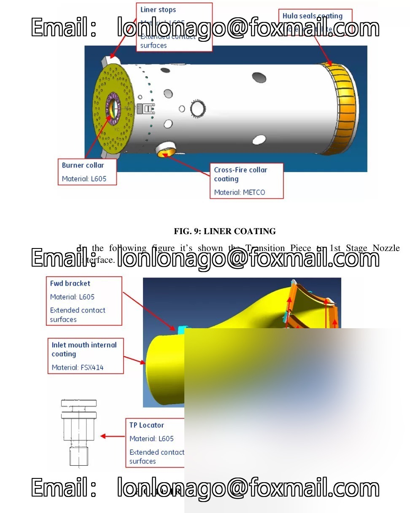
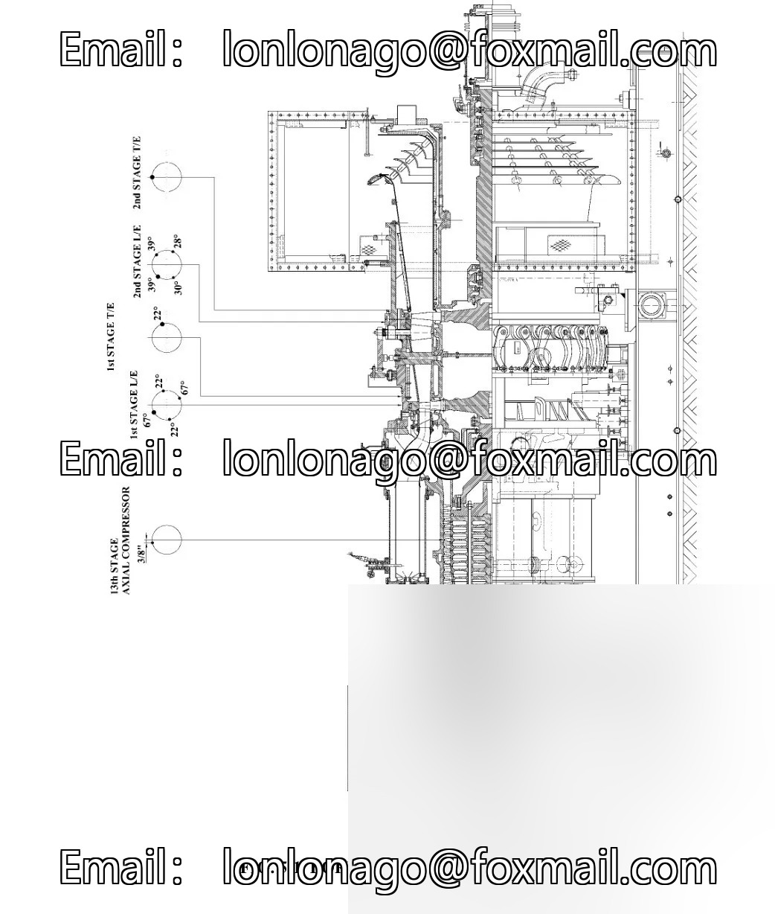

# GE Oil & Gas MS5002C gas turbine operation and maintenance training

## Body

GE Oil & Gas MS5002C gas turbine operation and maintenance training manual
660 pages, PDF
The content covers detailed processes of air and gas flows through components such as the combustion chamber, transition section, and combustion cover of MS5002C gas turbine, with coating materials (such as L605, Stellite, FSX-414) and installation location diagrams attached, suitable for equipment operation, maintenance, and upgrade training.
forfeit upon sale.
921-062

The manual covers operation and maintenance of the GE Oil & Gas MS5002C gas turbine for air and gas flow through the combustion chamber, transition section, combustion shield, and provides coating materials, installation location diagrams and is suitable for equipment operation, maintenance and upgrade training.

<!-- AI_ENRICHED -->

## Images

## Payment

Here is a pay link on Stripe ( https://buy.stripe.com/3cs8yP7sY87d0vu9AB ). Please contact me lonlonago@foxmail.com after funding $89, and I will send you a complete data files , thank you!

